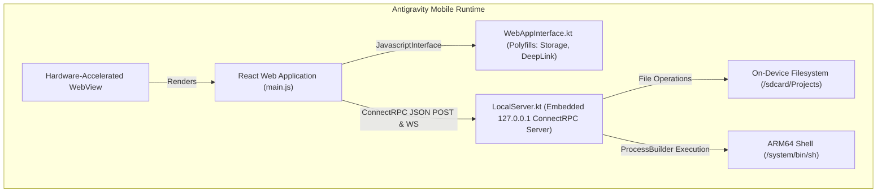

# Antigravity Mobile 🚀

[](https://developer.android.com)
[](docs/ARCHITECTURE.md)
[](LICENSE)

> A standalone, 100% on-device Android port of **Google Antigravity**—running the official desktop UI, local storage, and ARM64 shell executions completely without a PC.

---

## 🌟 Overview
Antigravity Mobile reverse-engineers Google's desktop Antigravity IDE/agent architecture and ports it natively into an Android application (`.apk`).

Unlike remote streaming or VPS thin-clients, Antigravity Mobile executes **100% on the device**:
* **Physical Local Storage:** Reads and writes code directly to `/sdcard/Projects`.
* **Local Terminal Execution:** Executes bash/sh scripts, build tools, and commands on your phone's ARM64 CPU via `/system/bin/sh`.
* **Exact Desktop UI:** Re-uses the extracted React/TypeScript frontend bundle from official releases, unlocking hidden mobile layouts (`Kh.Web.Mobile`) embedded in the original code.

---

## 🏗 Architecture
The application runs a lightweight loopback server on `127.0.0.1` inside the Android process, bridging the desktop ConnectRPC protocol with Android's system APIs.



---

## 📖 Deep Dives & Documentation
* [Reverse Engineering Journey & Dissection](docs/REVERSE_ENGINEERING_JOURNEY.md): Complete breakdown of unpacking `app.asar`, finding the 347 ConnectRPC endpoints, and discovering Google's hidden mobile layouts.
* [Troubleshooting & Bug Post-Mortems](docs/TROUBLESHOOTING.md): Detailed post-mortem of the "Black Screen of Death" bug caused by Android's asset decompression buffer semantics.

---

## 📥 Installation

### Option 1: Direct APK Install
1. Download [Antigravity-Mobile-v1.1.apk](https://github.com/) to your phone.
2. Open the file and tap **Install**.
3. Grant **All Files Access** (`MANAGE_EXTERNAL_STORAGE`) so Antigravity can read and edit your projects.

### Option 2: ADB Command Line
```bash
adb install -r Antigravity-Mobile-v1.1.apk
```

---

## 🛠 Building From Source

### Prerequisites
* JDK 21 (Adoptium OpenJDK recommended)
* Android SDK 36 (Build Tools 36.0.0)
* Gradle 9.1.0+

### Build Command
```bash
./gradlew assembleDebug
```
The compiled APK will be generated at `app/build/outputs/apk/debug/app-debug.apk`.

---

## 🗺 Roadmap
- [x] Reverse engineer Electron wrapper and extract desktop React bundles.
- [x] Reverse engineer ConnectRPC protocol (`347` service methods).
- [x] Embedded Kotlin loopback HTTP server (`LocalServer.kt`).
- [x] On-device storage (`/sdcard/Projects`) and ARM64 shell (`/system/bin/sh`).
- [x] Native Electron polyfill bridge (`WebAppInterface.kt`).
- [x] Resolve Android asset decompression buffer truncation bug.
- [ ] Connect `LocalServer.kt` to Gemini API with trajectory streaming.
- [ ] Implement Google Account OAuth Sign-In via Chrome Custom Tabs.

---

## ⚖️ Disclaimer
This project is an independent educational and research reverse-engineering effort demonstrating client-side agent architectures on mobile devices. All product names, trademarks, and registered trademarks are property of their respective owners.
